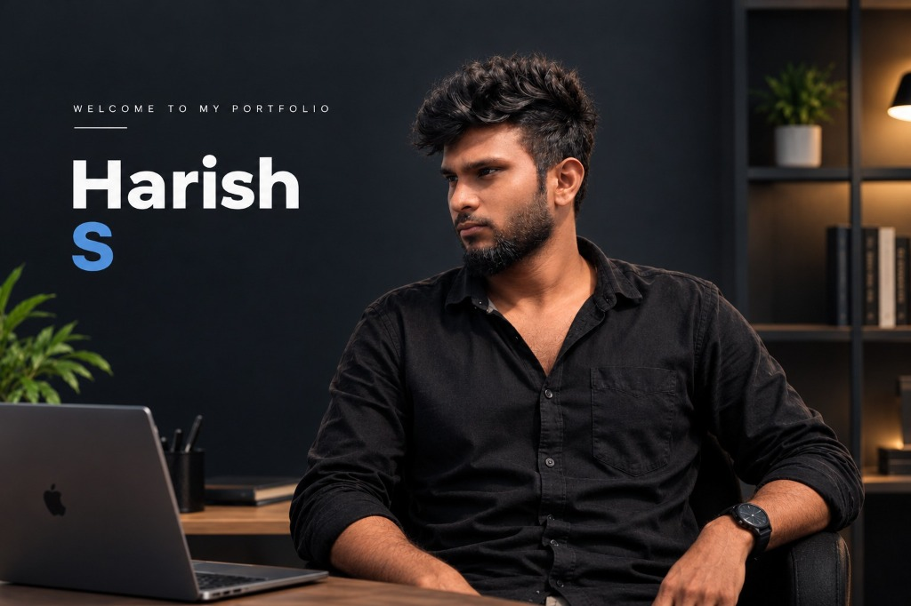

<div align="center">
  
  <h1>Harish S | Cybersecurity Portfolio</h1>
  <p><strong>A chromatic, interactive portfolio for cybersecurity engineering, reverse engineering, and secure systems work.</strong></p>
  <p>
    <a href="https://harish1630.github.io/portfolio/">View the portfolio</a>
    ·
    <a href="https://www.linkedin.com/in/harish-s-478b7a325/">LinkedIn</a>
    ·
    <a href="https://github.com/harish1630">GitHub</a>
  </p>
  <p>
    
    
    
  </p>
</div>

---

## About

A single-page portfolio introducing Harish S and highlighting work and interests across cybersecurity, network defense, memory forensics, reverse engineering, Rust systems programming, and data technology.

The interface uses a red-and-blue chromatic visual identity, terminal-inspired project cards, and a dark/light theme. It is built with plain HTML, CSS, and JavaScript—no framework or build step required.

## Highlights

| Interface | What it includes |
| --- | --- |
| **Chromatic themes** | Light and dark modes with the selected theme saved in the browser |
| **Interactive navigation** | Floating section navigation with scroll-aware active states |
| **About panel** | Tabbed Rust, JSON, and shell-style profile views |
| **Skills** | Filterable skill categories |
| **Projects & experience** | Terminal-style project cards and tabbed achievements |
| **Contact** | A contact form with email and mail-client fallback |
| **Responsive layout** | Adapts the portfolio for desktop and mobile screens |

## Preview

The profile image above is also used in the portfolio's hero section. Open the [live portfolio](https://harish1630.github.io/portfolio/) to explore the full interface.

## Run locally

No dependencies or build tools are needed. From the project directory, start a local web server:

```bash
python -m http.server 3000
```

Then open [http://localhost:3000](http://localhost:3000).

Alternatively, open `index.html` directly in a browser. A local server is recommended for consistent asset loading.

## Project structure

```text
.
├── index.html              # Portfolio sections and page content
├── 404.html                # Not-found page
├── robots.txt              # Crawler directives
├── assets/                 # Profile, project, certificate, and resume files
├── css/
│   └── style.css           # Layout, themes, and responsive styling
└── js/
    └── main.js             # Theme, navigation, filters, and interactions
```

## Customize

- Update page content and social links in `index.html`.
- Adjust colors, layout, and responsive rules in `css/style.css`.
- Edit interactive behavior in `js/main.js`.
- Replace the profile and portfolio media in `assets/`.

---

<div align="center">
  <sub>Designed and built by Harish S · Chennai, India</sub>
</div>
